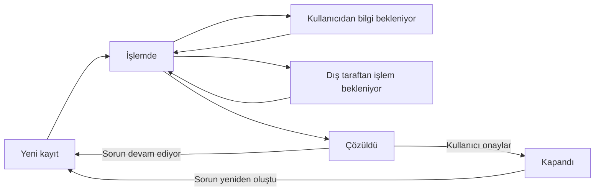

# IT Destek: araştırma ve ilk sürüm tasarımı

Araştırma tarihi: 16 Eylül 2026. Bu belge, Jira Service Management ve Zendesk'in resmi belgelerinden alınan işleyiş örneklerini ve DND CRM için önerilen ürün kararlarını ayrı ayrı açıklar. Bir ürünün özelliğinin burada anılması, DND modülünde aynı özelliğin veya entegrasyonun bulunduğu anlamına gelmez.

## İncelenen sistemlerin işleyişi

### Jira Service Management

Jira Service Management, çalışanların yardım talebini tek bir başvuru noktasından iletmesini; destek ekibinin talebi değerlendirmesini, bir sorumluya yönlendirmesini ve sonuçlandırmasını temel alır. Başvuru türüne göre form alanları ve iş akışları düzenlenebilir. Kuyruklar, destek ekibinin ele alacağı işleri toplar. [Atlassian: Service request management](https://www.atlassian.com/software/jira/service-management/product-guide/getting-started/service-request-management)

Hizmet isteği, örneğin yeni bir bilgisayar talebidir. Olay kaydı ise beklenmedik kesinti veya hizmet bozulmasıyla ilgilidir. Jira ayrıca kök neden araştırmasına yönelik ayrı bir problem yönetimi kategorisi sunar. Bu nedenle çalışan arayüzündeki günlük “sorun” sözcüğünü kullanmak, ilk sürümde ayrıca kapsamlı bir problem yönetimi süreci kurulmasını gerektirmez. [Atlassian: Main features](https://support.atlassian.com/jira-service-management-cloud/docs/get-to-know-the-main-jira-service-management-features/)

Olay önceliğinin belirlenmesinde etki ve aciliyet birlikte kullanılır: etki iş süreçlerinin ne ölçüde etkilendiğini, aciliyet ise müdahaleye ne kadar çabuk ihtiyaç duyulduğunu anlatır. [Atlassian: Impact, urgency and priority](https://support.atlassian.com/jira-service-management-cloud/docs/how-impact-and-urgency-are-used-to-calculate-priority/)

Kuyruklar, farklı sorumluluklara veya talep gruplarına odaklanmayı sağlar. Standart hizmet isteği alanları arasında etki, aciliyet, bekleme nedeni ve sınıflandırma alanları bulunur. [Atlassian: Queue groups](https://support.atlassian.com/jira-service-management-cloud/docs/prioritize-your-queues-by-using-groups/), [Atlassian: Default work type fields](https://support.atlassian.com/jira-service-management-cloud/docs/what-are-default-system-issue-types/)

### Zendesk

Zendesk bir destek kaydında ilk başvuruyu ve çözüm sürecindeki konuşmaları bir arada tutar. Kayıt sahibinin gördüğü yanıtlar ile yalnızca destek ekibinin gördüğü iç notlar ayrıdır. Kayıt bir destek sorumlusuna atanabilir. Temel yaşam döngüsü yeni, açık, bekleyen, çözüldü ve kapalı aşamalarını içerir. Çözüldü durumundaki kayda kullanıcının yanıt vermesi kaydı yeniden açabilir. Belgelenen standart akışta kapanış bir süre sonra otomasyonla gerçekleşir. [Zendesk: From support requests to tickets](https://support.zendesk.com/hc/en-us/articles/4408881925786-Lesson-1-From-support-requests-to-tickets)

Beklemenin sebebi ayrıdır: `Pending`, başvuru sahibinin yanıtını; isteğe bağlı `On-hold` ise üçüncü tarafın işlem yapmasını beklemeyi ifade eder. `Closed`, kaydın yeniden açılmaya ve güncellemeye kapandığı durumdur. [Zendesk: Ticket views and status categories](https://support.zendesk.com/hc/en-us/articles/4408888828570-Creating-views-to-build-customized-lists-of-tickets)

Güvenli indirme ayarı, dosyaların oturum açılarak alınmasını ve kayda bağlı eklerin erişiminin kayıt erişimiyle sınırlandırılmasını sağlar. Dosya boyutu ve türü için ayrıca kurallar tanımlanabilir. [Zendesk: Allowing attachments in tickets](https://support.zendesk.com/hc/en-us/articles/4408832757146-Allowing-attachments-in-tickets)

Olay geçmişinde kayıt alanlarının değişiklikleri ve ilgili güncellemeler incelenebilir; konuşma ile değişiklik geçmişi farklı görünümlerdir. [Zendesk: Viewing ticket events](https://support.zendesk.com/hc/en-us/articles/4408829602970-Viewing-all-events-for-ticket-updates)

## DND CRM için önerilen ilk sürüm

Aşağıdaki kararlar DND'nin mevcut ekip büyüklüğü ve CRM yapısı için yapılan tasarım seçimleridir. Jira veya Zendesk'in tüm işlevlerinin kopyalanması önerilmemektedir.

### Erişim ve görev ayrımı

- Aktif şirket kullanıcıları IT Destek üzerinden kayıt açar ve kendi kayıtlarını takip eder. Önizleme hesapları kapsam dışındadır.
- ADMIN tüm destek kuyruğunu görür; atama, öncelik, durum ve çözüm işlemlerini yönetir. Diğer roller, yalnızca kendi kayıtları bakımından başvuru sahibidir.
- Dijital Ekip üyeliği sorumluluk tanımlamak içindir; tek başına destek yönetimi yetkisi vermez.
- Dijital Ekip uzun süreli proje ve süreç takibini sürdürür. IT Destek, günlük arıza, şikâyet ve küçük taleplerin başvuru noktası olur.
- Kayıt ve dosya erişimi API'de de uygulanır. Kullanıcı arayüzünde bir düğmenin gizlenmesi yeterli değildir.

### Başvuru formu

| Alan | Amaç |
| --- | --- |
| Sorun / arıza veya hizmet isteği | Çalışmayan bir şey ile yeni bir ihtiyaç birbirinden ayrılır. |
| Konu ve açıklama | Beklenen davranış, gerçekleşen sorun ve tekrar etme adımları yazılabilir. |
| Kategori | Donanım, yazılım, erişim, ağ, e-posta gibi alanlarla ilk değerlendirme kolaylaşır. |
| Etkilenen sistem / cihaz ve konum | IT ekibi hangi uygulama veya çalışma alanına bakacağını anlar. |
| Etki ve aciliyet | Bir kişi, ekip veya şirket çapındaki etki ile işin durması ayrı değerlendirilir. |
| Dosyalar | Ekran görüntüsü ve ilgili belge başvuruya eklenebilir. |

Çalışan işin etkisini anlatır; IT ekibi son önceliği değerlendirebilir. Öncelik, tek başına yanıt veya çözüm süresi taahhüdü anlamına gelmez.

### Akış

1. Çalışan kayıt açar ve takip numarası alır.
2. ADMIN kuyruğa gelen kaydı değerlendirir, sorumluyu ve önceliği belirler.
3. İşlem ilerlerken çalışanla yazışılır. Destek ekibi kendi değerlendirmesini iç not olarak tutabilir.
4. Bekleme durumuna geçerken neden yazılır; kullanıcının yanıtı ile tedarikçi bekleyişi ayırt edilir.
5. Çözüm metniyle birlikte kayıt çözüldü durumuna alınır. Çalışan çözümü onaylayabilir veya sorunun sürdüğünü bildirerek yeniden açabilir.

Çözüm onayı DND için açık bir kullanıcı işlemidir. DND ayrıca kapanmış bir kaydın gerekçe yazılarak yeniden açılmasını destekler; bu, Zendesk'in kilitlenen `Closed` durumu ile aynı davranış değildir. Zendesk'in süreye bağlı otomatik kapanış kuralı DND'ye taşınmaz. İlk sürümde otomatik kapanış veya tanımlanmamış bir SLA takvimi bulunmaz.

### Kuyruk ve ayrıntı ekranı

- **Çalışan görünümü:** kendi kayıtları, durum, son güncelleme, sorumlu, konuşma ve çözüm.
- **ADMIN görünümü:** tüm kayıtlar, bana atanan, atanmamış ve kendi taleplerim görünümleri; durum, kategori, öncelik ve tür filtreleri.
- **Kayıt ayrıntısı:** başvuru bilgileri, dosyalar, konuşma, iç not, durum/atama işlemleri ve tarihçenin bir arada izlenmesi.
- **İzlenebilirlik:** kayıt açılışı, atama, durum ve öncelik değişiklikleri, yanıtlar ve çözüm işlemleri aktör ve zaman bilgisiyle tutulur.

### Konuşma ve dosya görünürlüğü

“Çalışana yanıt” kayıt sahibinin gördüğü konuşmaya eklenir. “İç not” yalnızca ADMIN görünümünde kalır; API yanıtları, dosya listeleri ve olay geçmişi de bu ayrımı korur. İç notta tutulan bilgi dolaylı olarak başvuru sahibine açılmaz.

Ekler, kayda veya ait oldukları mesaja bağlı özel dosyalardır. İndirme sırasında kullanıcı yetkisi yeniden doğrulanır. İlk sürümün izin verdiği dosya türleri ve boyut sınırı arayüzde açıkça belirtilmelidir.

### İlk sürüm sınırları

Başlangıç kanalı CRM içindeki formdur. E-posta, WhatsApp, harici yardım masası entegrasyonu, otomatik satın alma onayları, nöbet/escalation zinciri ve garanti edilmiş müdahale saatleri bu tasarımın varsayımları değildir. Bunlar ileride gerçek kullanım hacmi ve ekip çalışma saatleri belli olduğunda ayrıca tanımlanabilir.

## Doğrulama için kritik senaryolar

1. Bir çalışan başka bir çalışanın kaydını, ekini veya iç notunu doğrudan bağlantı ile okuyamaz.
2. Atama ve durum değişikliği aynı kaydın geçmişine doğru aktörle yazılır.
3. Bekleme nedeni ve çözüm açıklaması ilgili geçişlerde boş bırakılamaz.
4. Başvuru sahibi çözümü onaylayabilir; devam eden sorun için yeniden açma işlemi görünürdür.
5. İki sekmeden yapılan güncellemeler birbirinin değişikliklerini sessizce ezmez.
6. ADMIN yetkisi kaldırılmış veya hesabı pasif olmuş bir kullanıcı eski oturumuyla yönetim işlemlerine devam edemez.
